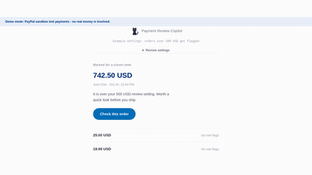

# Payment Review Copilot

A review queue for PayPal sellers. Sandbox payments are checked against your review settings, anything off-baseline is shown in plain language, and a short checklist walks you through the check before you ship. The app never holds, blocks, approves, or moves money - a human always decides.

Built for the PayPal AI Hackathon.

## Demo (19 seconds)

[](https://rishilifts.github.io/paypal-payment-review-copilot/demo/)

[Play the full 19-second demo](https://rishilifts.github.io/paypal-payment-review-copilot/demo/) - autoplays muted in the browser, with controls. Same file: [demo/copilot-demo-v4-fast.mp4](demo/copilot-demo-v4-fast.mp4)

## How it works

- Sandbox payments come in (poller or webhook intake) and are checked against your configured review settings (typical order size, markets). Every flag names the exact setting it deviates from - never country, name, or provider alone.
- Anything off-baseline appears first with the amount, buyer, a plain reason, and one "Check this order" action. Everything else sits quietly as "No rule flags".
- A 3-tick checklist gates "Everything checks out"; "Mark it for a closer look" parks the order. Review states are internal only - the PayPal payment itself is never touched.
- Optional AI note (Meta Muse Spark, `muse-spark-1.2` via `api.meta.ai`) explains a flag in plain words. It runs only when explicitly asked and the result is cached per payment + settings, so replays never re-call the API.

## Run it

```bash
npm start          # http://localhost:8787 - empty queue, rules-only review, no dependencies to install
```

With sandbox payments: set `PAYPAL_CLIENT_ID` / `PAYPAL_CLIENT_SECRET` (see `.env.example`), then `node scripts/sandbox-flow.js create 25.00` and capture the order. The AI helper needs `META_API_KEY`; webhook intake is in `scripts/setup-webhook.js`.

Tests: `node test/run-tests.mjs` (5 offline tests, zero network calls).

## Honest limits

- Sandbox test money only - no real payments.
- Flags are rule comparisons against configured settings, not fraud scores or predictions.
- Webhook signature verification is unit-tested with a mocked verifier; live webhook delivery is not verified end-to-end.

## License

MIT
